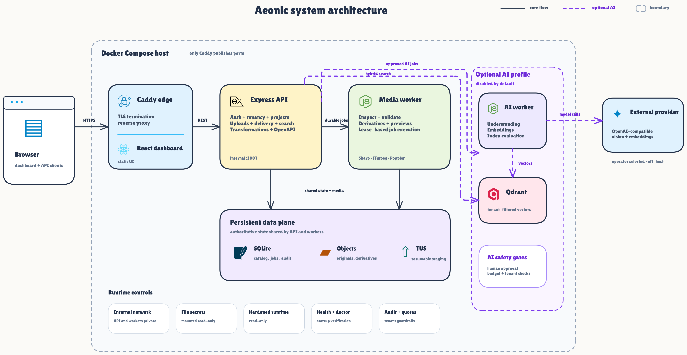

# Architecture

Aeonic is a single-host media platform composed of a public edge, an internal API, asynchronous
workers, and a persistent data plane. Optional intelligence is isolated so provider or vector-index
failure cannot block core uploads, transformations, catalog search, or delivery.

## Deployment boundary

The supported v1 topology is one Docker Compose project:

| Component | Responsibility | Exposure |
| --- | --- | --- |
| Caddy edge | TLS, HTTP/3 where available, dashboard assets, API proxying | Host ports 80 and 443 |
| Express API | Authentication, tenancy, projects, uploads, catalog, delivery, and job coordination | Internal network only |
| Media worker | Inspection, validation, image/video processing, and document previews | Internal network only |
| SQLite | Authoritative catalog, jobs, audit history, and control-plane state | Shared persistent volume |
| Object storage | Immutable originals and generated derivatives | Local volume or S3-compatible service |
| TUS staging | Temporary state for resumable uploads | Persistent Aeonic-owned path |

Only Caddy publishes host ports. API and worker containers have read-only roots, dropped
capabilities, `no-new-privileges`, bounded temporary storage, and access only to required volumes.

## Core request and processing flow

1. A browser or service client sends HTTPS traffic to Caddy.
2. Caddy serves the React dashboard or proxies a versioned REST request to Express.
3. The API authenticates the caller and applies organization, project, and action policy.
4. Synchronous catalog operations use SQLite; media work is recorded as a durable leased job.
5. The worker claims the job, reads staged or immutable media, validates configured limits, and
   publishes derivatives only after successful processing.
6. Delivery resolves an immutable original or transformation and applies visibility, signing,
   range, and cache rules.

SQLite remains authoritative. Local object storage and SQLite share the `aeonic-data` volume in the
default Compose profile. S3-compatible storage changes the object backend, not the control plane.

## Authentication and tenant isolation

Human users authenticate with Better Auth cookie sessions. Service clients use hashed,
project-scoped API keys. Every protected operation is checked against an organization, project,
and action; developers and viewers additionally require an explicit project assignment.

Storage keys and vector queries carry tenant scope. The API never trusts a provider or vector
result as authorization evidence. See [authentication and authorization](authentication.md).

## Optional intelligence

The `ai` Compose profile adds an AI worker and Qdrant. It is disabled by default.

- The API records approved or explicitly requested intelligence jobs.
- The AI worker prepares bounded inputs and calls the configured OpenAI-compatible provider.
- Qdrant stores tenant-filtered embeddings; SQLite stores index provenance and remains authoritative.
- Search falls back to local FTS5 when intelligence is disabled or unavailable.
- Mutating agent workflows require an immutable plan, human approval, single-use authorization,
  worker-side revalidation, and audit history.

The external model provider is outside the Compose trust boundary. Provider output is untrusted
input. Read [optional semantic search](semantic-search.md) and
[media workflow agents](agent-workflows.md) before enabling the profile.

## Availability and scaling model

Aeonic v1 favors operational simplicity and recoverability over horizontal control-plane scaling.
It supports one API writer and worker processes sharing a local SQLite data plane. Job leases,
heartbeats, bounded retries, graceful shutdown, liveness, and readiness support process recovery.

Active-active API replicas, shared network filesystems, and Kubernetes are outside v1 support.
Scale media capacity by sizing the host and worker limits, then use S3-compatible object storage
when local capacity is not appropriate. Use the [performance guide](performance.md) to validate a
specific host instead of extrapolating published results.

## Recovery boundary

A recoverable installation requires a logically consistent copy of SQLite and its matching objects.
Caddy state is operationally useful but is not application data. Optional Qdrant collections can be
rebuilt from authoritative state, although retaining snapshots may reduce recovery time.

See [deployment](deployment.md) and [upgrade and rollback](upgrade.md) for backup requirements.
